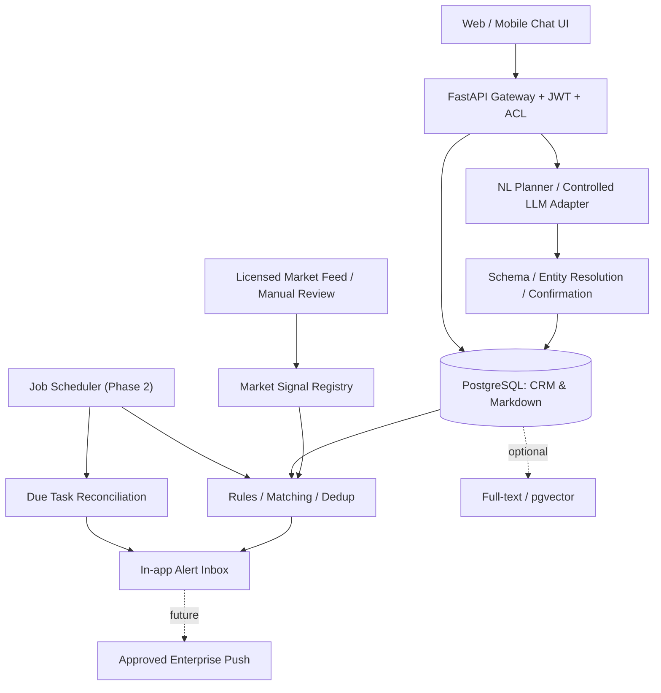
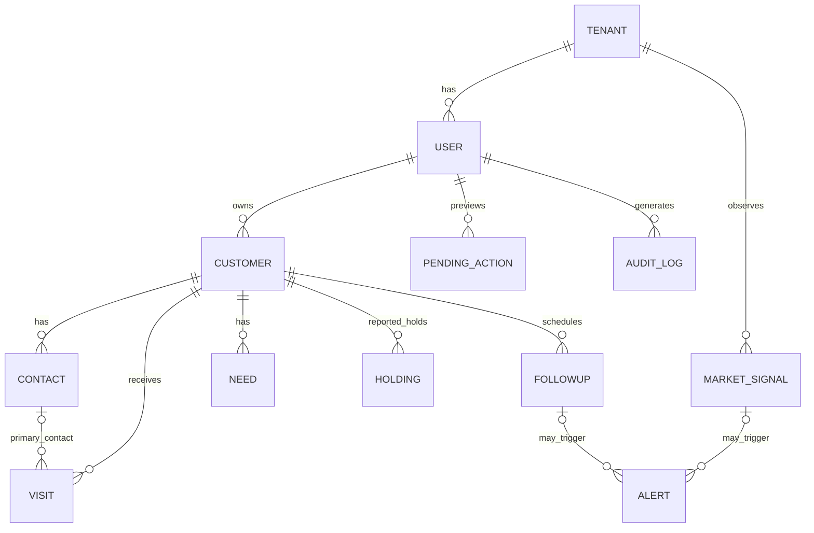

# 公募基金销售 AI CRM：总体架构与落地路线

> 版本：0.1 参考实现 | 场景：中国境内公募基金渠道/机构/个人客户维护 | 业务时区：Asia/Shanghai  
> **本工程是可运行的研发起点，而非通过金融机构安全、法务或合规验收的生产系统。**

## 1. 为什么选择混合存储

你希望一线销售说一句话，系统能理解客户关系、保留沟通上下文、提醒跟进，并在风格轮动时提示需要联系的客户。纯 Markdown 或纯数据库都不能很好地承载全部需求。

| 方案 | 优点 | 缺点 | 结论 |
|---|---|---|---|
| 全 Markdown / 文件夹 | 可读、好迁移、适合长纪要 | 多人并发、去重、日期检索、精细 ACL、审计复杂 | 不推荐作唯一事实库 |
| 全关系数据库 | 易于去重、约束、搜索、统计、权限 | 长篇拜访背景表达不自然；自然语言上下文容易碎片化 | 必不可少，但不够完整 |
| 关系数据库 + Markdown 正文 + 可选检索索引 | 事实强约束、叙述灵活、AI 可读取、可控合规 | 需要明确事实与解释的边界 | **本项目采用** |

**原则：数据库负责“确定了什么”，Markdown 负责“为什么、如何沟通”；AI 是输入理解器和只读分析器，不是事实的最终裁判。**

Markdown 文本在本 MVP 中保存在 PostgreSQL `TEXT` 字段中（例如 `visits.body_md`），而非依赖服务器本地磁盘的散落文件；API 可导出 `.md`。因此结构化字段与叙述正文共享备份、权限、审计和事务边界。未来若需要对象存储，可将大附件放入合规 S3 兼容存储、在数据库保存引用与校验和。

## 2. 业务目标

1. 客户：个人/机构；一个机构拥有多个联系人；一个销售拥有多个客户。
2. 关系记忆：每次拜访时间、对象、渠道、目的、纪要、关键结论、约定事项。
3. 客户需求：主题、紧急程度、状态、产品方向、痛点以及履约进度。
4. 产品：客户声称购买/持有的产品、产品代码、记录金额、日期、来源与核验状态。
5. 任务：约定下次拜访日期、到期提醒、循环回访、完成和补充后续任务。
6. 市场：合规授权的数据源/人工观察形成标准事件，与客户需求/持仓标签做连接。
7. 隔离：多个基金公司/部门租户隔离；同租户多个销售默认私有；日后精细共享审批。
8. 自然语言：无需人手逐格录入；写操作必须有预览、确认、审计与幂等保障。

## 3. 总体组件

- `FastAPI`：访问控制、数据 API 和自然语言交互入口。
- `PostgreSQL 16`：事实源、Markdown 正文、审计、待确认提案、RLS。
- `SQLAlchemy 2 + Alembic`：ORM 与数据库版本迁移。
- `Argon2 + JWT`：参考版身份认证；生产改接公司 OIDC/SSO、MFA 与员工生命周期管理。
- `LLM Adapter`：兼容受控 Chat Completions JSON 接口，默认关闭。
- `Rules Engine`：只做“主题标签交集 + 严重度阈值 + 一客户一事件去重”的透明匹配。
- `Reminder API`：查询和生成站内提醒；真正每天定时触发需要接入任务调度。
- 前端：仓库含无外部 JS 依赖的实验性 UI；正式建设推荐前后端分离。

## 4. 关键数据关系

**重要：机构和联系人是两个实体。** 不能把机构名放在“联系人姓名”字段里，也不能把联系人角色嵌入一个无法检索的 Markdown 段落。拜访默认绑定一个主联系人，其他参与人可先写纪要；多参与人关联表 `visit_attendees` 属于下一迭代。

## 5. 业务边界与关键设计决策

### 5.1 两种隔离必须同时存在

- **Tenant（租户）**：基金公司、独立业务主体或被批准的强隔离组织。
- **Owner（销售负责人）**：一个租户内的个人工作空间，默认不能查看同事客户。
- 所有主要业务表都含 `tenant_id` 与 `owner_user_id`。
- 服务层查询强制两个条件；PostgreSQL 中又使用 RLS 策略二次保护。
- 子表与客户表之间使用 `(tenant_id, owner_user_id, customer_id)` **复合外键**，尽可能禁止跨主体关联。
- 管理员有用户开设/市场事件发布权限，但默认**不因此获得每名销售的客户明细权限**。
- 协作共享不是“全租户所有人可看”；第二期应使用 `customer_acl` + 审批 + 共享有效期 + RLS 策略扩展。

### 5.2 口述持仓不是已核验持仓

本项目 `holdings` 的 `source="sales_reported_unverified"`，`verified=false`。即使销售说“客户买了某某基金”，也不意味着交易已被确认；重复提到不代表多个新的交易流水。本 MVP 每次保存的是**一次申报事实/观察快照**，不是核算系统。生产版建议：

1. `products` 基金主数据（唯一产品代码、代码历史、风险等级、主题标签、有效期）。
2. `position_snapshots` 来源、记录时间、对账时间及确认状态。
3. `transactions` **仅在合规授权、销售业务平台支持时**由权威系统同步。
4. 资产规模、盈亏、净值、持有天数只根据权威来源计算，不能靠 AI 猜测。

### 5.3 市场提醒不是自动建议交易

事件格式为 `kind + severity + tags + headline + evidence_url + happened_on`。现有规则：
- 严重度 `< 3` 不产生告警；
- 匹配客户持仓已确认录入的“主题标签”或开放需求主题标签；
- 一个客户对同一个事件最多一条提醒；
- 提醒只说明匹配依据和核验状态，不输出买卖、赎回或收益判断；
- 只有租户管理员可以发布市场事件；
- 当前版本的市场事件通过人工受控接口输入，**不含实时行情采集**。

### 5.4 AI 写入采用两段式

1. `/assistant/interpret`：理解一句话，关联有权限的客户，返回预览 `pending_action_id`。
2. 销售在 UI 校对客户、内容、日期、标签、购买描述。
3. `/assistant/confirm/{id}`：重新核验客户权限，在单事务中创建拜访、需求、持仓、任务，并写审计日志。
4. 重复确认同一个 ID，返回历史执行结果而非重复写入。

对“本周谁需要回访”等查询直接读取授权数据，**不需要写入确认**。

## 6. 一个完整业务故事

用户说：

> 今天拜访了王敏，需求：关注红利策略；30天后回访。

系统行为：

- 在当前销售有权访问的联系人中找到“王敏”，确定机构“华星资管”。
- 准备 `log_visit`（今天）＋ `record_need`（红利策略）＋ `create_followup`（30 天后）三项操作。
- 预览确认后分别写入 `visits` / `needs` / `followups`。
- 未来用户询问“未来 30 天哪些客户要跟进”时读取任务表。
- 如果存在“红利风格风险”标准事件，则开放需求或已申报持仓的主题交集可生成联系提醒。
- 如果“王敏”对应多个机构，则要求说出机构，不任意选择一个。

## 7. 功能成熟度矩阵

| 能力 | 当前代码 | 生产前仍需建设 |
|---|---|---|
| 机构、个人客户、机构多联系人 | 可运行 | 工商信息校验、联系人变更历史 |
| 租户和销售隔离 | 应用层测试已覆盖；Postgres RLS 迁移已写 | 在真实 PG 环境执行权限穿透/渗透测试 |
| 自然语言汇报 | 规则解析可运行；LLM 网关可选 | 高精度中文时间 NLP、口音/语音、端到端评估 |
| 按日期追踪、周期回访 | 可运行；站内提醒按需触发 | 定时作业、短信/企微审批消息与退订 |
| 需求与客户背景更新 | REST API 可用 | AI 指代消解、版本冲突处理、需求关联人 |
| 声称购买/持有产品 | 可运行但均未核验 | 权威持仓对账、产品主数据和历史快照 |
| 市场事件与告警 | 人工事件、标签规则可运行 | 合法行情接入、策略审批、阈值回测、风控复核 |
| Markdown 客户知识库 | PG 文本 + `.md` 导出 | 对象存储、全文搜索、引用式 RAG |
| 安全审计 | 参考版写入日志、操作哈希 | 不可篡改归档、SIEM、权限开通审批、密钥托管 |
| 网页聊天入口 | 实验性 UI | 设计系统、无障碍、SSO、移动适配验证 |

## 8. 推荐实施里程碑

### P0：2—4 周，内部封闭原型
- 使用本仓库 API + 开发 UI；
- 做 2 个机构类型/个人客户测试集，验证多人隔离；
- 人工登记客户、联系人、拜访、下次跟进与产品持有陈述；
- 用脱敏/模拟数据测试解析准确率和确认率；
- 完成内控、隐私与模型供应商初审。

**验收**：100% 写入前确认；非授权客户请求为 404；双确认不会重复写入；100 个预先定义的语句测验留下准确率报告。

### P1：4—8 周，部门试点
- 企业 SSO、审批式客户共享、账号回收；
- 产品主数据和客户机构档案去重；
- 任务队列 + 日历 + 邮件/企微**经公司批准的**触达；
- 实际 PostgreSQL RLS CI 与压力测试；
- 统一的 Markdown 编辑器和检索界面。

**验收**：跨用户越权零容忍，恢复演练通过，任务提醒 SLA 可度量，敏感数据不进入外部未批准模型。

### P2：8—16 周，市场事件联动
- 接入有授权的数据源，建立时效和质量监控；
- 事件归一化：行业、风格、资产、波动、成交情绪、风险等级；
- 多规则引擎：主题暴露、需求匹配、冷却期、重复抑制、黑白名单；
- 风险提示形成“待复核客户清单”；人工批准实际客户沟通；
- 独立风控测试：历史回放、误报率、告警疲劳、可解释性。

### P3：成熟生产系统
- 细粒度团队共享、任务移交、离职交接；
- CRM 全文检索/可选向量库、RAG 引用溯源；
- 适当性关联但**由权威规则服务判定，不交给 LLM**；
- DLP、密钥轮换、WORM 审计、备份、灾备、双人审批；
- 数据分级与保留策略审计。

## 9. 推荐非功能指标（目标，不是当前性能承诺）

| 项目 | 原型目标 | 生产目标建议 |
|---|---|---|
| API 可用性 | 开发可运行 | 99.9% + 故障演练 |
| 任务数据一致性 | 单事务完成 | Outbox + at-least-once worker + 幂等 |
| 客户数据隔离 | 双过滤 + RLS | 定期权限回归 + 渗透测试 |
| 自然语言意图识别 | 规则/可选 LLM | 关键动作高精度，低置信度必澄清 |
| 事件告警 | 管理员人工发布 | 来源签名、去重、延迟监测和回测 |
| 恢复能力 | 本地快照 | 按内部业务等级定义 RPO/RTO |

## 10. 技术选型背后的取舍

- 先用单体模块化 FastAPI，**不要一开始拆十几个微服务**。租户权限跨多个服务会增加误用风险。
- PostgreSQL 是主事实源，Redis、Kafka、pgvector 都是可选扩展；当前业务量不足以证明必须投入这些基础设施。
- 自然语言先进行**严格有限操作解析**，再走显式确认；比让通用 Agent 自由调 SQL 更容易合规审计。
- RAG 的价值在“引用历史沟通”，不在替代资产余额、任务日期等精确查询。
- 维护一份可审查的主题标签字典，初期宁可少提醒，也不要靠模糊模型乱关联行情与客户。
