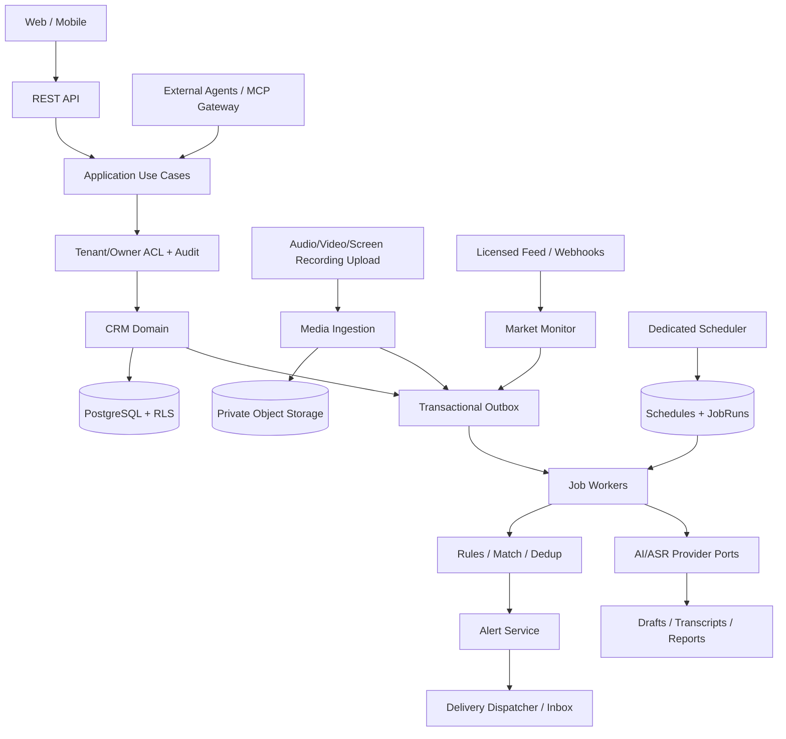

# 公募基金销售 AI CRM：V2 架构演进方案

> 基于公开仓库 [CheeseMac/fund-crm-demo](https://github.com/CheeseMac/fund-crm-demo) 的设计评审。  
> 设计产物，不是已实现的功能或生产系统。所有示例均为虚构数据。

## 1. 核心架构决策

**CRM 自己负责业务时钟、提醒规则、持久化任务、权限和通知可靠性；外部服务负责提供数据、模型处理或接受授权调用。**

| 模块 | 谁触发/负责 | 设计边界 |
|---|---|---|
| 定期回访/逾期任务 | CRM 内部 Scheduler | 不依赖用户是否登录或外部 Agent 是否在线 |
| 日报/周报/月报 | CRM 内部 Scheduler | SQL 统计优先；AI 只是可选叙述层 |
| 市场实时/收市数据 | 授权第三方 Feed 或内部行情服务 | 只提交带来源的事实/观察 |
| 市场异常识别 | Market Monitor（可独立进程） | 阈值、数据时间、质量及规则版本可核验 |
| 关联哪些客户 | CRM 内部 Rule Engine | 必须逐租户/销售执行授权筛选 |
| 生成提醒 | CRM 内部 Alert Service | 去重、冷却、用户偏好、审计 |
| 提醒投递 | Notification Dispatcher | 站内优先；外部渠道须审批 |
| 自然语言/音视频摘要 | AI Provider/ASR Adapter | 无数据库写权限；结果是草稿 |
| 外部 Agent 查询/汇报 | MCP Gateway | 重用 CRM Application Service 及权限 |
| 对客营销/交易 | 独立企业批准流程 | 不允许 AI/MCP 自动绕开审批 |

### 为什么不全部交给外部 Agent 定时触发？

外部 Agent 的订阅状态、网络、客户端权限和运行时都可能变化。它适合“代表本人来查或提交草稿”，不能充当公司 CRM 的唯一任务时钟。**统一内部调度及事件执行机制，支持外部市场事件和外部 Agent 请求作为入口**，是可扩展又可靠的做法。

### 从现有仓库看到的关键缺口

- `frontend/index.html` 的提醒提前天数存在浏览器 `localStorage`，点击“立即同步”才生成对应提醒；没有服务器内的持久化用户通知计划。
- `app/api.py` 市场信号提交后同步调用客户匹配；`app/services/market.py` 按用户扫描匹配，对大规模用户不适合放在 HTTP 请求进程。
- `app/services/parser.py` 同时包含正则解析、模型 HTTP 调用、实体匹配，需要分离。
- 没有多媒体存储模型、异步作业记录、消息 Outbox、发送渠道投递状态或 MCP 入口。
- 当前演示账号与 SQLite 只适用于虚构环境；正式多租户须继续真实 PG RLS、审计、密钥管理和合规评估。

## 2. 推荐的逻辑架构



**部署方式**：保留一份代码库，分别运行 `crm-api`、`crm-scheduler`、`crm-worker` 和未来的 `crm-mcp` 进程；共享 PostgreSQL，但只有经过授权的业务服务能操作相应数据。多媒体二进制放私有对象存储；初期不强制 Kafka、Redis、向量库或复杂工作流平台。

## 3. 四类触发统一接入

| 触发类别 | 示例 | 首要职责 |
|---|---|---|
| `schedule` | 每日 08:30 生成待办；周一 08:45 生成周报 | 系统内部持久化计划 |
| `domain_event` | 已完成拜访、任务关闭、录音上传成功 | CRM 事务内写 Outbox |
| `external_observation` | 市场波动超阈值、授权数据推送、研究员确认事件 | 输入数据验证→标准化→内部匹配 |
| `mcp/manual` | 用户通过 Agent 或页面要求做一次总结 | 走相同的业务用例与审批 |

### 市场事件实际链路

```text
授权行情/研究输入
 → 原始 market_observation（来源、时效、指标、单位）
 → 数据质量检查/风格阈值规则
 → market_signal_candidate（可能需要人工复核）
 → market_signal_accepted
 → outbox_events
 → match_customers worker（按 tenant + owner 范围）
 → alert（reason, source, rule_version, dedup_key）
 → notification_deliveries
 → 站内提醒 / 经批准的企业触达
```

“市场情绪低迷/高涨”必须对应透明指标及数据时间，或明确标为人工研究观点；不能仅根据模型一句话进行真实客户级风险推送。**客户内部提醒 ≠ 对客推荐文案 ≠ 自动交易。**

### 定期回顾实际链路

```text
每周一 Scheduler
 → job_runs（owner_id、周期、唯一执行键）
 → SQL ReportBuilder（拜访数、未关闭需求、逾期、下周安排）
 → 可选 Summarizer AI（生成文字说明 + 证据引用）
 → generated_reports（统计快照、Markdown、模型/来源版本）
 → alert + notification_deliveries
```

模型不可用时生成确定性报告，不阻塞业务；不要用大模型判断哪些任务到期，使用 SQL 日期计算。

## 4. 调度/事件数据模型（新增）

| 表 | 关键字段 | 作用 |
|---|---|---|
| `task_schedules` | `tenant_id,owner_user_id,kind,rrule,timezone,next_run_at,enabled,misfire_policy` | 持久化计划 |
| `job_runs` | `schedule_id,scheduled_for,status,attempt,lease_until,worker_id,idempotency_key` | 单次运行与重试 |
| `outbox_events` | `event_id,tenant_id,actor_id,event_type,payload,occurred_at,delivery_status` | 业务写入与异步事件同事务 |
| `user_notification_prefs` | `user_id,timezone,lead_days,quiet_hours,channels,digest_mode` | 多设备统一提醒设置 |
| `rule_definitions` | `rule_type,conditions_json,version,cooldown,enabled` | 可解释的内部规则 |
| `notification_deliveries` | `alert_id,user_id,channel,status,attempts,provider_id,last_error` | 投递审计 |
| `generated_reports` | `user_id,period,metrics_json,summary_md,source_ids,model_version` | 周报/日报留痕 |
| `market_observations` | `provider,external_key,observed_at,received_at,value,quality` | 市场事实 |
| `market_signal_candidates` | `observation_id,rule_version,severity,status,reviewer` | 事件审核 |

### 可靠性要求

- `UNIQUE(schedule_id, scheduled_for)` 防止重复物化同一计划；
- `UNIQUE(tenant_id, owner_user_id, dedup_key)` 防止重复客户提醒；
- Outbox 与 CRM 事实变更在同一 DB 事务；Worker 采用至少一次处理 + 幂等结果；
- 使用 `FOR UPDATE SKIP LOCKED`、领取 lease/heartbeat、重试/死信；
- Worker 停机恢复后可补跑或按 `misfire_policy` 合并/跳过，操作留审计；
- DB UTC 时间戳 + IANA 时区；区分自然日/工作日/中国市场交易日；
- scheduler 只能物化/领取计划，**不能自动以超级用户任意读取所有销售的客户**；后续任务按被授权的 owner scope 执行。


## 5. 多媒体：会议、录音、录屏、图文资料

### 5.1 前端建议

先保留现有四页主导航，在“客户详情”下增加“素材与会议”标签，在秘书对话输入框旁增加“上传文件 / 开始录音 / 屏幕录制”入口；当素材多时再独立出第五页“素材库”。

用户流程：

1. 选客户/机构、会议日期、联系人/参与人，授权并提交录音、视频、录屏、PDF、PPT、图片或 Markdown；
2. 查看上传、病毒扫描、转写/抽帧/内容提取的处理状态；
3. 转写稿按时间轴显示说话人、置信度和对应素材位置；
4. 用户修改说话人标签与内容；AI 生成待审核 Markdown 会议纪要；
5. AI 提取潜在需求、持仓陈述、回访行动项，仅生成 `PendingAction`；
6. 用户逐条确认后，正式写入 `visits` / `needs` / `followups`；
7. CRM 记录附带 evidence ref，点击可跳到音视频具体秒数或文档页码。

### 5.2 存什么、不存什么

| 资产 | 存储 | 必须包含 |
|---|---|---|
| 原始录屏、录音、视频、图片 | 私有 S3 兼容对象存储 | key/version/checksum/分类/上传人 |
| 文件元数据 | PG `media_assets` | tenant/owner/customer/meeting/MIME/size/state |
| 上传与扫描状态 | PG `media_processing_jobs` | stage/status/attempt/error |
| ASR 时间分段 | PG `transcript_segments` | start_ms/end_ms/speaker/text/版本 |
| 人工修订转写 | PG `transcripts`（正文可为 Markdown） | version/reviewer/source_asset |
| 正式会议纪要 | PG `meeting_minutes` | body_md/审阅状态/来源 |
| PDF 页索引、视频帧、缩略图 | 对象存储 + `media_derivatives` | asset_id/时间/页号/安全凭据 |
| 需求和任务证据 | PG `evidence_refs` | entity_id/asset_id/segment_id/时间或页 |

**不要将视频/录音转为 Base64 塞进 Markdown，也不要靠 Markdown 文件路径作为 ACL。**

### 5.3 处理流水线

```text
initiate upload (authorizes customer)
  → expiring upload ticket to quarantine object key
  → multipart/chunked upload
  → complete (size+checksum+MIME+signature)
  → malware scan + media probe + limits
  → move to private ready storage
  → MediaReady event
  → ASR / optional diarization / OCR / video keyframes
  → transcript + evidence segments
  → human review
  → AI summary/structured extraction (optional)
  → PendingAction preview
  → human confirmation
  → CRM records + immutable source links
```

- 浏览器录屏需用户主动授权屏幕及麦克风权限；系统音频的可录制能力因浏览器平台而异。
- 对录音、屏幕、参会人身份及个人信息的收集，应先完成公司隐私与金融业务合规评估；必须控制敏感信息外发和可见范围。
- “原始转写”与“人工修订转写”应同时保留版本，不得静默覆盖原件。
- 生成任务/持仓陈述时附上出处；销售口述买入不等于交易对账确认。
- 下载时先查 owner/tenant ACL，再签发短时对象访问凭据；文件可见权限不得脱离 CRM。
- 隔离区、文件扩展名/MIME/魔数校验、解析器沙箱、大小和时间限制、恶意内容扫描为上线前必备。
- 上传票据必须限定对象 key、时效、尺寸和指定操作，防止任意覆盖/越权；存储版本和 hash 便于追溯。

### 5.4 多媒体建议 API

```text
POST /api/v2/media/uploads/initiate
POST /api/v2/media/{id}/complete
GET  /api/v2/media/{id}
GET  /api/v2/media/{id}/playback-ticket
GET  /api/v2/media/{id}/transcript
POST /api/v2/meetings
GET  /api/v2/meetings/{id}
POST /api/v2/meetings/{id}/extract-draft
POST /api/v2/assistant/actions/{pending_id}/confirm
```

大文件实际字节流应经直传对象存储；常规 CRM API 与 MCP 不必代理原始 GB 级数据。

## 6. 大模型功能彻底解耦（Port + Adapter）

CRM 内部业务永远只依赖固定的数据契约，不依赖某个模型 SDK。

```python
class IntentExtractor(Protocol):
    async def extract(self, request: InterpretRequest) -> DraftActions: ...

class Transcriber(Protocol):
    async def transcribe(self, request: TranscriptionRequest) -> TranscriptDraft: ...

class Summarizer(Protocol):
    async def summarize(self, request: SummaryRequest) -> SummaryDraft: ...

class MarketDataProvider(Protocol):
    async def observations(self, interval: TimeRange) -> list[MarketObservation]: ...

class MediaStore(Protocol):
    async def initiate_upload(self, request: UploadRequest) -> UploadTicket: ...
```

其中 `DraftActions` 是无副作用的候选操作，必须经 `resolve_actions` 和 `confirm_actions` 才能修改客户资料。`TranscriptDraft`、`SummaryDraft` 都带模型、prompt 版本、来源 ID、状态、置信度/警示字段。

架构演进分三步：
1. **先抽接口不拆部署**：`app/ai/ports.py`、`app/ai/adapters/rule.py`、`app/ai/adapters/llm.py`，旧 `parser.py` 改为 facade；Use Case 与 AI provider 通过 DI 交互；
2. **后台异步化**：媒体与周报由 AI Worker 调用 Provider，JobRun 保存耗时、结果、错误及成本；失败不影响 CRM 客户 CRUD、确定性报告和提醒；
3. **独立进程**：AI Gateway 接受版本化 JSON 请求，返回候选信息，模型/ASR/OCR 可以由批准的私有服务替换。

尤其不要把 `tenant_id`、数据库超管凭据或整个客户明细库暴露给 LLM。由核心 CRM 先限定检索范围、最小化内容，再调用模型；AI 输出永远不是直接执行 SQL 的指令。

## 7. MCP：外部 Agent 的受限入口

MCP 不是后台调度器。为 MCP 设计独立 `crm-mcp` Adapter，重用 CRM 业务 Application Service：

```text
Web UI → REST Auth & API ───────┐
                                ├─ Application Use Cases → Domain / DB
Agent → OAuth → MCP Gateway ────┘
```

### 7.1 首批 MCP tools

| 工具 | 权限 | 类型 |
|---|---|---|
| `customers.search` | crm:customer:read | 只读 |
| `customers.get_context` | crm:customer:read | 只读、裁剪输出 |
| `visits.list` | crm:visit:read | 只读 |
| `followups.list_due` | crm:task:read | 只读 |
| `alerts.list` | crm:alert:read | 只读 |
| `reports.get_weekly` | crm:report:read | 只读 |
| `assistant.prepare_actions` | crm:draft:write | 提案，不改事实 |
| `assistant.confirm_actions` | crm:action:confirm + 审批令牌 | 高风险写入，服务端确认 |
| `media.request_upload` | crm:media:write | 获取受限上传票据 |
| `alerts.acknowledge` | crm:alert:write | 低风险操作，仍需审计 |

不要开放：任意 SQL、全租户导出、租户/权限修改、直接删除审计、发送未经合规批准的对客营销资料、基金交易工具。

### 7.2 MCP 权限细节

- 采用受支持的 Streamable HTTP MCP 协议和 OAuth 授权流；公司 OIDC 可以充当身份提供方；
- 由服务器根据已验证 Token 决定 `tenant_id`、`owner_user_id` 和 scopes，而非信任工具参数；
- 非交互服务身份必须与真人代理身份分离，不能默认以全权限管理员执行；
- HTTP 接入校验 Origin、防重放、限流、审计，Token 使用正确 audience、issuer 和最小权限；
- “模型说用户同意了”不是批准依据。确认高风险操作需要服务端产生、绑定用户/提案 hash/版本的短期一次性 approval；
- MCP 调用不能绕过 CRM 原有的 PendingAction、复合 FK 与 PostgreSQL RLS；
- MCP 版本协议会变化，针对所选版本做兼容测试，不把旧 SSE 行为当作始终有效。

官方 2026-07-28 MCP Streamable HTTP 已修改传输形态（包括移除旧式 GET stream 与协议会话），部署时应锁定 SDK 与兼容矩阵。

## 8. 推荐代码组织

```text
app/
  routes/                   # REST 入站；迁移时避免与现有 app/api.py 同名冲突
    customers.py visits.py media.py market.py reports.py reminders.py
  application/              # UI / MCP / Job 统一调用
    customers.py prepare_actions.py confirm_actions.py
    ingest_media.py ingest_market.py build_report.py dispatch_alert.py
  domain/                   # 业务实体/规则，不能依赖模型 SDK
    entities.py events.py policies.py rules.py
  infrastructure/
    db/                     # ORM / RLS / repositories
    object_storage/         # 私有 S3/本地虚构开发版
    messaging/              # Outbox + job_store
    ai/                     # ports + rule/LLM/ASR/OCR adapters
    market/                 # licensed feed adapters
  workers/
    scheduler.py
    outbox_dispatcher.py
    media_processor.py
    market_matcher.py
    summary_worker.py
    delivery_worker.py
  mcp/
    server.py tools/
  security/
    identity.py policy.py approval.py
frontend/
  index.html
  ... 先扩展客户详情“素材与会议”，逐步组件化
alembic/versions/
  ... 每个新增模型做增量迁移
```

不要一开始拆成十几个微服务。**先分代码边界，再分运行进程，最后按真实负载和治理需求分独立服务。**


## 9. 推荐 API 及事件协议

### 9.1 建议增加的业务 API

```text
POST /api/v2/media/uploads/initiate       # 请求短期上传票据
POST /api/v2/media/{asset_id}/complete    # 校验后排异步处理
GET  /api/v2/media/{asset_id}             # 状态、元数据
GET  /api/v2/media/{asset_id}/transcript  # 结构化转写/校对版本
GET  /api/v2/media/{asset_id}/access      # 验权后签短时访问凭据
POST /api/v2/meetings                    # 客户会议和参会人
POST /api/v2/meetings/{id}/extract-draft  # 只生成待确认动作
GET  /api/v2/me/notification-preferences
PUT  /api/v2/me/notification-preferences  # 提前天数/渠道/静默时段
GET  /api/v2/schedules
POST /api/v2/schedules                   # 创建用户可见的定期计划
POST /api/v2/schedules/{id}/pause
GET  /api/v2/jobs/{id}                   # 排队/运行/失败/重试结果
GET  /api/v2/reports?kind=weekly
POST /api/v2/reports/generate            # 手工生成也排入 job
POST /internal/market/observations       # 内部受权服务入口
GET  /api/v2/alerts
```

现有 `/assistant/interpret`、`/assistant/confirm`、`/customers` 等路径保留；逐步由统一 Application Service 实施新旧路由共用的访问控制。

### 9.2 Event Envelope

```json
{
  "event_id": "opaque-uuid",
  "event_type": "market.signal.accepted.v1",
  "schema_version": 1,
  "tenant_id": "tenant-uuid",
  "actor_id": null,
  "source": "approved-market-monitor",
  "occurred_at": "2026-10-29T07:30:00Z",
  "trace_id": "opaque-trace-id",
  "subject": {"signal_id": "signal-uuid"},
  "idempotency_key": "provider|symbol|observed_at|rule_version"
}
```

**队列 Envelope 不复制全量客户姓名、持仓金额、录音正文。** 消费方凭有权限的内部身份重新读取最小必要资料。

## 10. 数据、权限与运行的边界

- 租户级 `market_signal` 可以由专用市场管理员/受限服务发布；客户级 `alerts` 只能由 owner scope 生成/读取。
- Scheduler 只需要读取待执行计划元数据与 JobRun，不应持有任意客户数据读权限；Worker 在处理可信 JobRun 时获取绑定的 tenant+owner context。
- 真正的后台作业不要简单地关闭 RLS 或长期使用 `BYPASSRLS` 超级账号。可以用最小化的队列表权限、受控存储过程/专门角色领取任务，业务数据读取仍用普通受限角色。
- 同一公司不同销售的客户默认隔离；媒体文件、转写和报告也要与客户相同的 tenant/owner 复合授权。
- 将来允许共享客户，新增 `customer_acl / team_access_grants`，不能只把 `owner_user_id` 改为 nullable 作为共享。
- `seed_demo` 使用的演示用户密码只适用于完全虚构的本地环境，不得联网生产使用。
- 录音录像、金融信息和原始素材在接入真实业务前应完成合法收集、告知、权限、留存期限和公司合规审批；对客发送消息更要独立审核。
- 生产环境的通知渠道可设计为站内优先、企业批准的消息渠道次之，不把未核验市场观点直接推送到客户。

## 11. 开发任务与 PR 顺序

| PR | 工程内容 | 必须交付的验收 |
|---|---|---|
| PR1：Application 层 | `confirm_actions`、`create_task`、`market_match` 从路由中抽出；AI Provider 接口 | 原有 9 项演示测试继续通过，API 响应兼容 |
| PR2：自主触发 | `task_schedules`, `job_runs`, `outbox_events`, `user_notification_prefs`、独立 scheduler/worker | 到点自动提醒、掉线重启补偿、无重复提醒 |
| PR3：多媒体存储 | `media_assets`、对象存储、扫描、下载权限、限制与审计 | 跨用户越权失败、未扫描素材不可解析 |
| PR4：会议与 AI | 会议、转写、引用片段、纪要草稿与人工确认 | 转写可校对、来源可回跳、AI 无权直接改事实 |
| PR5：市场与报告 | 市场数据 adapter、候选事件质量、内部规则、确定性周报与可选 AI | 无数据不乱提示、来源可追溯、模型离线可出周报 |
| PR6：MCP | OAuth 受限入口、首批只读工具、草稿、用户审批确认 | Agent 与 Web 权限一致、不能跨 tenant/owner |

不建议一开始就引入：通用用户自编程规则引擎、全天候 Agent 自动买卖、图数据库、全面微服务、Kafka+Temporal 全家桶或无约束的向量召回。

## 12. 验收与故障测试矩阵

1. **多个 Scheduler**：同时启动两个实例；相同 schedule_id + scheduled_for 只产生一份逻辑 JobRun。
2. **断点恢复**：数据库已提交 Outbox 后应用崩溃，Worker 恢复应继续完成。
3. **重复事件**：相同行情事件经 API/Webhook 重发，不再生成相同客户 Alert/重复投递。
4. **用户设置**：提醒提前天数从 A 设备设置，B 设备及服务端定时任务一致。
5. **时区**：测试跨日/节假日/非交易日，明确自然日与工作日规则。
6. **权限隔离**：所有新媒体、JobRun、Report、EvidenceRef 真实 PostgreSQL RLS 测试，不仅靠 SQLite。
7. **安全上传**：恶意格式、伪造 MIME、超额文件、重复上传、无权读取、未扫描下载都被拒绝。
8. **来源追溯**：一条从会议中提取的需求可定位音频起止秒或文档页码。
9. **AI 失败**：LLM / ASR 超时后产生可重试失败记录；核心客户、任务及确定性周报不受影响。
10. **MCP 认证**：错误 token audience、缺 scope、跨 owner、伪造 `approval_token` 均拒绝。
11. **成本控制**：音视频处理和模型调用按租户/用户/媒体类型有配额、可观测账单与超时限制。
12. **内容保留**：审批删除、保留/冻结、版本历史、原始素材与转写之间的溯源有效。

## 13. 参考资料

- 公开仓库：<https://github.com/CheeseMac/fund-crm-demo>
- MCP Authorization（2026-07-28）：<https://modelcontextprotocol.io/specification/2026-07-28/basic/authorization>
- MCP Streamable HTTP（2026-07-28）：<https://modelcontextprotocol.io/specification/2026-07-28/basic/transports/streamable-http>
- MCP Python SDK：<https://github.com/modelcontextprotocol/python-sdk>
- PostgreSQL 锁语义：<https://www.postgresql.org/docs/16/sql-select.html>
- OWASP 文件上传安全清单：<https://cheatsheetseries.owasp.org/cheatsheets/File_Upload_Cheat_Sheet.html>
- S3 预签名 URL：<https://docs.aws.amazon.com/AmazonS3/latest/userguide/using-presigned-url.html>
